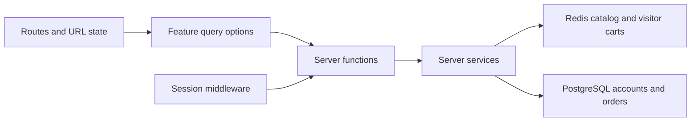

# Architecture review

Reviewed against the installed React 19 and TanStack packages, alongside the official [React component design](https://react.dev/learn/thinking-in-react), [custom hook](https://react.dev/learn/reusing-logic-with-custom-hooks), [TanStack external data loading](https://tanstack.com/router/latest/docs/framework/react/guide/external-data-loading), and [Start server function](https://tanstack.com/start/latest/docs/framework/react/guide/server-functions) guidance.

## Data flow

- `getRouter()` creates a QueryClient for each router instance. Server requests do not share one user's query cache with another.
- Catalog filters and selected product variants live in validated URL search parameters. Components derive their display from those values; local state is reserved for drafts, disclosure, and transient feedback.
- Shared query options keep loader prefetching and component reads on the same cache keys. The installed Query package recommends `queryClient.query()` and `infiniteQuery()`; these were retained rather than replacing them with older, deprecated methods.
- Server functions own validation and the network boundary. Private address and checkout functions apply session middleware directly. Route guards remain navigation behavior rather than the authorization boundary.
- Address queries include the current user ID in their keys. Visitor carts deliberately use their own HTTP-only cart cookie. Checkout data is loaded through its authenticated server boundary.
- SQL owns account and order transactions; Redis owns the live supplier catalog and visitor carts. The checkout transaction and notification outbox remain together.

## Refactoring

- Split sign-in submission, fields, and presentation. Sign-in and sign-up now share social-provider placement, navigation links, plugin content, and pending-state calculation.
- Separate the account trigger from account-menu content. Remove its forced dark theme while retaining plugin-provided links and actions.
- Render one responsive sort control and one result announcement. Sorting and filter controls have separate components; sort choices come from the same canonical list used by URL validation.
- Share catalog-card details so regular and discounted cards use the same product link, store label, prices, and savings calculation.
- Centralize locale names and the cookie contract in a module that does not depend on React or date formatting.
- Consolidate theme, base, storefront, and control styling in `src/styles.css`. Motion owns section reveals, card interactions, artwork scaling, and popover entrances, with `MotionConfig reducedMotion="user"`. Control selection and hover rules have one owner; selected menu options retain their appearance across pointer and keyboard focus.
- Define the previously missing medium-radius token. Keep reduced-motion overrides in one final stylesheet instead of relying on conflicting component rules.
- Share popup surfaces and transitions across select, combobox, popover, and account menus. Keep their positioning and layout in the primitives.
- Match authentication page metadata to the active translated view. Translate known catalog color labels without changing supplier values, and check translation coverage and interpolation tokens in tests.
- Remove the unused navigation-menu component and the retired chat integration.

## Boundaries to preserve

Keep storage imports out of UI components, use server functions for private operations, and retain the existing Biome import restrictions. Keep monetary calculations, inventory validation, and transaction handling in server services rather than presentation components. Add components or hooks around a distinct responsibility or repeated behavior; line count alone is not a reason to split a cohesive operation.

The development database is `zipwit`, with the `postgres` role and a fresh initial migration. Production still requires its actual host/TLS settings, shipping configuration, payment verification process, and operational Redis persistence/replication setup; this review does not deploy or replace those services.

## Verification

All 265 tests across 52 files pass, including translation key and placeholder parity, configured and literal storefront copy coverage, auth titles, color labels, social-provider layout, and the single responsive sort control. Type checking, Biome, Knip, deprecated-API checks, and the production build also pass.

The built app was checked at desktop and mobile widths for overflow, images, navigation, language switching, reduced motion, and product option selection. Account menus, sorting, and filter choices use the same surface and selected colors; hovering the selected sort option leaves its text and background unchanged. Local registration and HTTP sign-in succeeded, and the temporary account and session were removed.

A recovered React render warning occurred intermittently when leaving Deals during development checks. The built-app browser run reported no exceptions. The route retains the documented, typed `Route.useSearch()` pattern.
